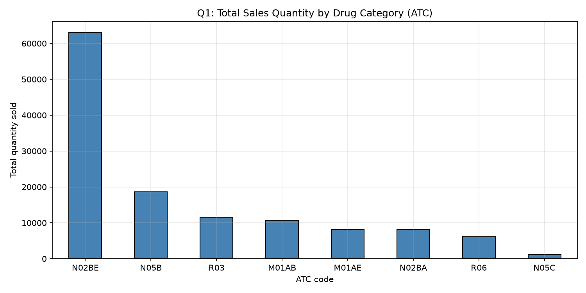
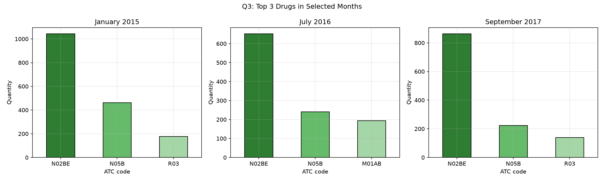

# 💊 Analysing Pharmaceutical Sales Data

Python, Pandas and Matplotlib analysis of daily pharmacy sales (2014-2019) across 8 ATC drug categories. Built to answer the stock-planning questions a pharmacy manager would ask.

## 🎯 Business problem
A pharmacy needs to know which drug categories drive sales, what sells in which period, and whether respiratory drugs are seasonal, so it can buy and stock the right amounts at the right time.

## 📂 Project structure
```
Analysing-pharmaceutical-sales-data/
├── data/salesdaily.csv   <- download from Kaggle (Pharma Sales Data)
├── outputs/              <- charts (PNG) and tables (CSV)
├── analysis.ipynb        <- main notebook
├── analysis.py           <- same analysis as a script
├── analysis_part2_forecast.ipynb  <- weekday analysis + Jan 2020 forecast
├── analysis_part2_forecast.py     <- Part 2 as a script
├── requirements.txt
└── README.md
```

## ▶️ How to run
```bash
pip install -r requirements.txt
jupyter notebook          # open analysis.ipynb -> Restart & Run All
```

## 🔍 Key findings
> Fill these in AFTER running the notebook, using the INSIGHT lines it prints.

| # | Question | Answer |
|---|----------|--------|
| Q1 | Highest total sales category | `___` (`___` units, `__`% of all sales) |
| Q2 | Top 3 drugs overall | `___`, `___`, `___` |
| Q3 | Top drug: Jan 2015 / Jul 2016 / Sep 2017 | `___` / `___` / `___` |
| Q4 | Sold most often in 2017 | `___` (`___` days) |
| Q5 | Highest average daily sales | `___` (`___` units/day) |
| Q6 | R03 peak month / low month | `___` / `___` (`__`% difference) |

### Charts




## 💡 Business recommendations
> Rewrite in your own words based on your results. Examples of the shape:
1. Prioritise stock for the top 3 categories, which account for most of the volume.
2. Review stock monthly, because the top seller changes between months.
3. Increase R03 stock before its peak month.
4. Use average daily sales to set daily reorder levels.

## ⚠️ Limitations
- Data is per ATC group, not individual brands.
- "Sold most often" is measured as days with sales greater than zero.
- Only quantities are given, with no prices, so revenue cannot be analysed.

## 🛠️ Tools
Python 3, Pandas, Matplotlib, Jupyter

## 👤 Author
Khuliso - [GitHub](https://github.com/KhulisoJohn)
