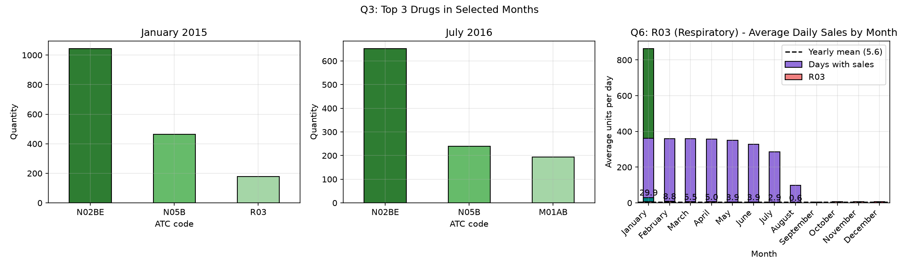
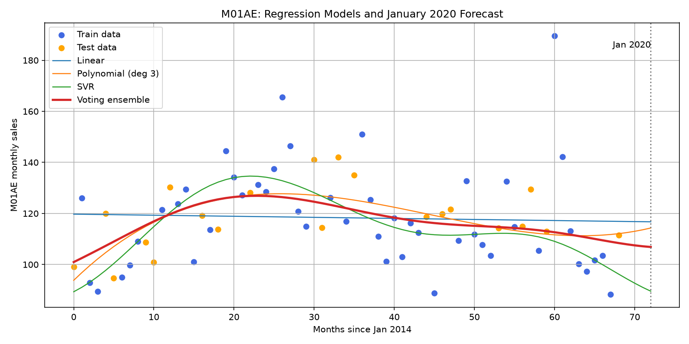

# 💊 Analysing Pharmaceutical Sales Data

Project page: https://roadmap.sh/projects/pharmaceutical-sales-data

Python, Pandas, Matplotlib and scikit-learn analysis of 5+ years of daily pharmacy sales (Jan 2014 - Oct 2019) across 8 ATC drug categories. Part 1 answers six stock-planning questions. Part 2 adds a weekday analysis and a January 2020 sales forecast.

## 🎯 Business problem
A pharmacy needs to know which drug categories drive sales, what sells and when, and whether respiratory drugs are seasonal, so it can buy and stock the right amounts at the right time.

## 📂 Project structure
```
Analysing-pharmaceutical-sales-data/
├── data/salesdaily.csv                 <- download from Kaggle (Pharma Sales Data)
|                            <- charts (PNG) and tables (CSV)
├── src/
    |── outputs/
│   ├── analysis.py                     <- Part 1 (6 questions)
│   ├── analysis_part2_forecast.py      <- Part 2 (weekday analysis + forecast)
│   ├── analysis.ipynb                  <- Part 1 notebook
│   └── analysis_part2_forecast.ipynb   <- Part 2 notebook
├── requirements.txt
└── README.md
```

## ▶️ How to run
Run everything from the project root, not from `src/`:
```bash
pip install -r requirements.txt
python3 src/analysis.py
python3 src/analysis_part2_forecast.py
```
Or start `jupyter notebook` from the project root and open the notebooks.

## 🔍 Part 1: Key findings (daily data, 2,106 days, no missing values or duplicates)

| # | Question | Answer |
|---|----------|--------|
| Q1 | Total sales by category | N02BE leads with 63,005 units (49.4% of all sales), then N05B (14.6%) and R03 (9.1%). N05C is the lowest at 1.0% |
| Q2 | Top drugs | N02BE, N05B, R03, M01AB, M01AE. The top 3 make up 73.1% of all units |
| Q3 | Top 3 in Jan 2015 / Jul 2016 / Sep 2017 | N02BE is #1 in all three months and N05B is #2. Third place is R03, M01AB, R03 |
| Q4 | Sold most often in 2017 | N02BE sold on 361 days, M01AB and M01AE on 360 |
| Q5 | Highest average daily sales | N02BE at 29.9 units/day, about 51x N05C (0.6/day) |
| Q6 | Is R03 seasonal? | Yes. Peak in December (7.9/day), low in July (3.0/day), a peak about 2.7x the low. Sales are high from October to February |




## 🔍 Part 2: Weekday analysis and forecast

| Question | Answer |
|----------|--------|
| Best day for M01AE | Sunday (1,384.94 units in total) |
| Best day for each drug | M01AB, N02BE and R06: Saturday. N02BA: Tuesday. N05B: Wednesday. N05C: Friday. R03: Monday |
| Drug sold most on Mondays in 2017 | N02BE (1,160.56 units) |
| Check against the published solution | All three top-3 month lists matched |

### January 2020 forecast for M01AE (monthly units, 69 months of data, 70/30 train/test split)

| Model | R² (test) | RMSE (test) | Jan 2020 prediction |
|-------|-----------|-------------|---------------------|
| Linear | -0.040 | 12.59 | 116.7 |
| Polynomial (degree 3) | 0.382 | 9.70 | 114.3 |
| SVR | 0.043 | 12.08 | 89.6 |
| Voting ensemble | 0.320 | 10.18 | 106.9 |

The ensemble predicts about **107 units** of M01AE for January 2020. The models disagree widely (90 to 117), so treat this as a rough estimate, not a precise forecast.



## 💡 Business recommendations
1. **Protect N02BE stock first.** It is half of all sales, sells almost every day and leads every period examined. Running out would hurt the most.
2. **Build R03 stock before October.** Respiratory sales are more than double in the winter-to-summer comparison, so stock up ahead of the peak and cut back for the July-August low.
3. **Keep N05C stock minimal.** It averages 0.6 units a day and sold on only 99 days in 2017.
4. **Plan staffing and deliveries by weekday.** The busiest day differs by drug (R03 on Monday, M01AE on Sunday, N02BE on Saturday).
5. **Use average daily sales to set reorder levels,** and review the top 3 each month, because third place changes.

## ⚠️ Limitations
- Data is per ATC group, not individual brands, so "drug" means ATC category.
- "Sold most often" is measured as days with sales greater than zero. The leaders are close (361 vs 360 days), so quantity is used as a tie-breaker.
- No prices are given, so revenue and profit cannot be analysed.
- The forecast uses time as its only input, so it ignores seasonality. R² is low for most models (best 0.38), the polynomial curve can swing when extended past the data, and the random train/test split is generous because the models see months from every year. October 2019 is excluded as incomplete.
- My validation check compared the order of drug names only. The M01AB volume for July 2016 (194.5) is slightly lower than the 203.97 in the published solution, so small differences from that source exist.

## 🚀 Next steps
- Add Month as a second input to the forecast so it captures seasonality.
- Test the forecast on the latest months only (train on early years, test on later ones).
- Repeat the forecast for R03 and N02BE.

## 🛠️ Tools
Python 3, Pandas, Matplotlib, scikit-learn, Jupyter

## 👤 Author
Khuliso - [GitHub](https://github.com/KhulisoJohn)
